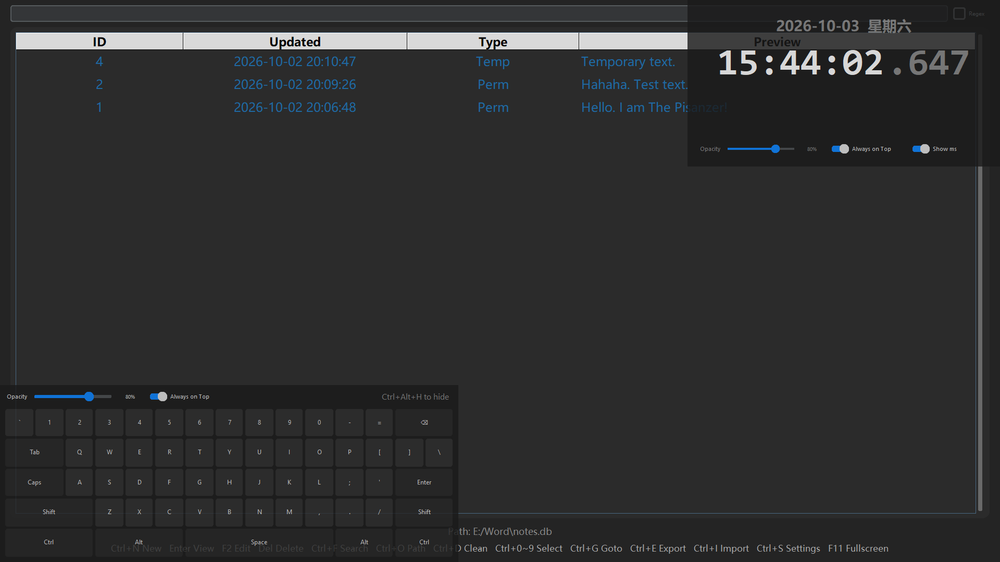

# Tempus

A flat, dark-themed desktop clock for Windows.

Click and drag anywhere on the clock to move it around your desktop. No title bar, no bloat, just time.

> Part of the **Elemental Series** — small, keyboard-driven, dark-themed desktop tools.



## Features

- Flat, dark UI built with CustomTkinter
- Frameless window with drag-to-move support
- Opacity slider (30% – 100%)
- Always-on-Top toggle
- Toggle milliseconds display
- Fullscreen mode (F11)

## Requirements

- Windows
- Python 3.10+
- `customtkinter`

## Install

```bash
pip install customtkinter
```

## Run

```bash
python Tempus.py
```

## Build exe

Before building, generate the icon if you haven't already:

```bash
python make_icon.py
```

Then run:

```bash
pyinstaller --onefile --noconsole ^
  --add-data "tempus_icon.ico;." ^
  --icon="tempus_icon.ico" ^
  --name=Tempus Tempus.py
```

## Shortcuts

| Key | Action |
|-----|--------|
| F11 | Toggle fullscreen |
| Esc | Close the app |
| Space | Toggle milliseconds display |

## Elemental Series

| Element | Project | Status |
|---------|---------|--------|
| N | Notebook | ✅ |
| K | Keyboard | ✅ |
| T | Tempus | ✅ |
| H | Hash | 🚧 |

## License

AGPL-3.0